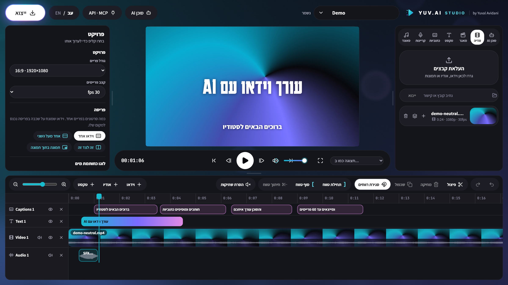
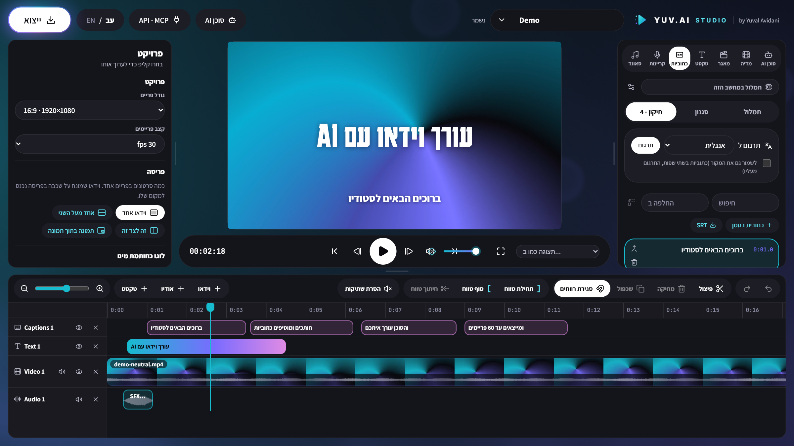
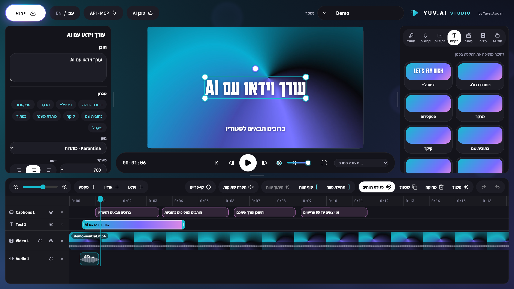
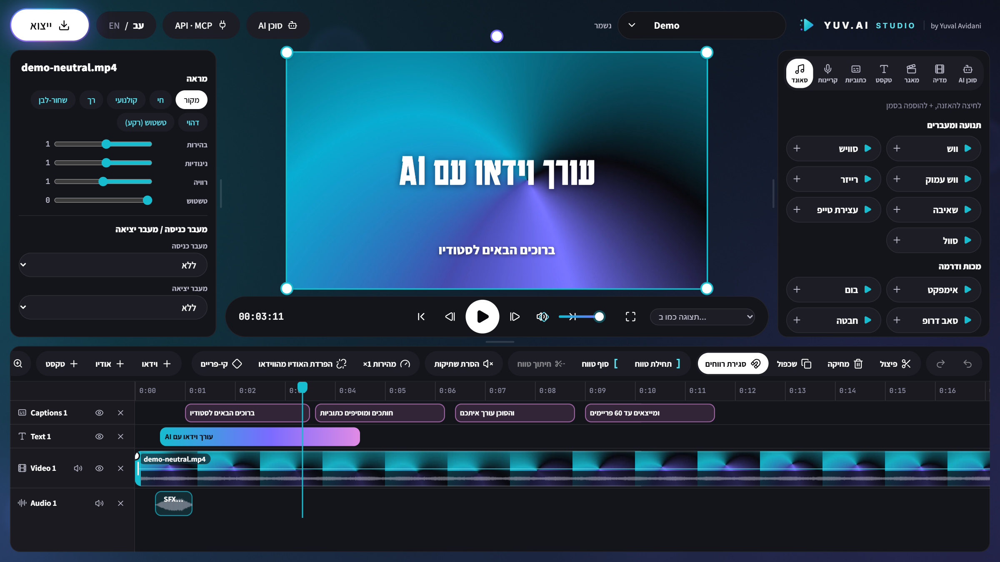
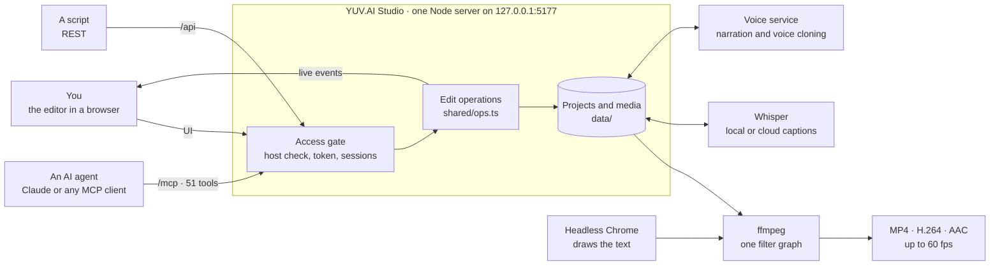

<div align="center">


# YUV.AI Studio

**A video editor that runs in your browser, on your own machine, and edits together with an AI agent.**

Cut · Hebrew and English captions · narration · export at up to 60 fps · REST API · 51 MCP tools · works on your phone

[Quick start](#quick-start) · [What it does](#what-it-does) · [Guides](#guides) · [How it works](#how-it-works) · [License](#license)

</div>



## What it does

| | |
|---|---|
| **Cut** | Trim the start and the end, split anywhere, delete with the gap closed, mark a range with `I` / `O` (or `[` / `]`) and cut it from every track, remove silences automatically. Export only what is left. |
| **AI agent** | A chat in the editor that edits while you watch, with your own key for Claude, OpenAI, Grok, Groq, OpenRouter, Together, or a local model (Ollama, LM Studio). A glow around the frame and a guided cursor show each step it takes. Big edits wait for your approval of its plan, and its edits come back as a review: each change marked on the timeline, kept or taken back on its own. |
| **MCP and REST** | Every edit is an API call and one of 51 MCP tools. Connect Claude Code, Claude Desktop, Codex, Cursor, VS Code or Gemini CLI, and the open editor shows the agent working live. |
| **Captions** | Hebrew and English. Transcribed on your computer (faster-whisper) or through an API when there is no GPU. Word-by-word highlight, 9 styles, and an editor to fix what the transcription got wrong. Captions follow your cuts. |
| **Translated captions** | Captions in another language than the speech (Hebrew, English, Spanish, French, German, Italian, Portuguese, Russian), or two languages at once, each caption keeping its timing. |
| **Voice** | Narration from text, in Hebrew or English, placed at the playhead. Pick a voice from the library or clone your own from a clip you choose. |
| **On your phone** | A mobile mode: upload from the gallery (resumable, no 100 MB limit), make and fix captions, translate them, pick a look, ask the agent, and export for Reels, TikTok, Shorts or YouTube. Installs to the home screen. The work runs on your computer. |
| **Layers** | Video, B-roll, image overlays, audio, titles. Drag, resize and rotate anything directly on the preview. Drag a clip in between others and they move to make room. |
| **Motion** | Zooms and keyframes on any clip or title: position, size, rotation and opacity, with easing. `K` puts a keyframe at the playhead. Ready-made slow zooms and punch-ins. |
| **Speed** | 0.25× to 4× per clip (or any value from 0.1× to 8×). |
| **Style** | 9 title styles, text animations, colour looks, 15 transitions, 26 built-in sound effects, blend modes, any Google Fonts family or your own fonts. |
| **Free stock** | B-roll, overlays, photos, music and sound effects from Pexels, Pixabay and Openverse, searched inside the editor, with each licence and credit kept. |
| **Export** | MP4 (H.264 + AAC) up to 60 fps, with presets for YouTube, Shorts, Reels, TikTok, Instagram, X and LinkedIn, fit-or-fill reframing and a safe-zone preview. The text is drawn by the same code in the preview and in the export, so they match. |

The interface is in Hebrew and English.

| Fix the transcription | Narration and voices |
|---|---|
|  |  |

| Titles and text styles | Sounds, looks and transitions |
|---|---|
|  |  |

## Quick start

You need [Node.js](https://nodejs.org) 22 or newer, `ffmpeg` and `ffprobe` on your PATH, and Chrome or Edge (it draws the text layer during export).

```bash
git clone https://github.com/hoodini/yuv-studio.git
cd yuv-studio
npm install
npm run build
npm start
```

Open http://127.0.0.1:5177 and drop a video on the window.

For captions, pick one:

- **On this computer:** `pip install faster-whisper` (a GPU with CUDA makes it fast; it also runs on CPU, slowly).
- **Through an API:** open the Captions tab, press the settings icon and paste an OpenAI, Groq or ElevenLabs key.

For narration, open the Voice tab and paste the key of the voice service (see [docs/VOICE.md](docs/VOICE.md)).

**Or let an AI agent do all of it:** paste the prompt in [docs/AI_INSTALL_PROMPT.md](docs/AI_INSTALL_PROMPT.md) into Claude Code, Codex, Cursor or Gemini CLI. It installs what is missing, builds and starts the studio, connects itself over MCP and checks that everything works.

## Guides

| | |
|---|---|
| [What's new](CHANGELOG.md) | What changed in each version |
| [Using the editor](docs/USER_GUIDE.md) | Cutting, layers, captions, shortcuts |
| [Transcription](docs/TRANSCRIPTION.md) | Local Whisper, cloud providers, fixing captions |
| [Voice and AI clips](docs/VOICE.md) | Narration and voice cloning, importing generated clips by link |
| [AI agent](docs/AGENT.md) | The chat in the editor, providers and keys, plans to approve, reviewing its changes |
| [MCP server](docs/MCP.md) | Connect an AI client; the 51 tools; example prompts |
| [REST API](docs/API.md) | Endpoints and edit operations |
| [Use it from anywhere](docs/REMOTE.md) | A private address on your own domain through a Cloudflare Tunnel |
| [Architecture](docs/ARCHITECTURE.md) | Diagrams of the logic and the infrastructure |
| [AI install prompt](docs/AI_INSTALL_PROMPT.md) | One prompt that makes an agent install everything, on Windows, macOS or Linux |

## How it works

One project model and one set of edit operations sit in the middle. The editor, the REST API and the MCP server are three doors to the same operations, which is why an agent can do anything a person can do in the interface, and why the open editor follows along live.



| Part | Where |
|---|---|
| Project model and every edit operation (shared by UI, API and MCP) | `shared/types.ts`, `shared/ops.ts` |
| Text and caption drawing (the same code in preview and export) | `shared/renderText.ts` |
| REST API, uploads, live events, access control | `server/index.ts` |
| Export: one ffmpeg filter graph, text pictures from headless Chrome | `server/export.ts` |
| Transcription, local and cloud | `server/transcribe.ts`, `server/transcribe.py` |
| Narration and voice cloning | `server/voice.ts` |
| MCP tools | `server/mcp.ts` |
| AI agent (providers, the tool loop, snapshots) | `server/agent.ts` |
| Editor UI (React) | `src/` |

Projects, uploads, exports and settings live in `data/`, which is not committed. Copy `.env.example` to `.env` to configure the port, the data folder, Whisper models, keys and remote access.

## Security

The studio listens on `127.0.0.1` and refuses requests from other websites and other host names. It can read any file path it is given on the local machine, which is what lets an agent import footage from anywhere on the disk, so never put it on a network without the access token or Cloudflare Access described in [docs/REMOTE.md](docs/REMOTE.md).

Found a vulnerability? Please report it privately, as described in [SECURITY.md](SECURITY.md).

## License

YUV.AI Studio is free and open-source software under the **[GNU Affero General Public License v3.0](LICENSE)**. You may use, study, change and share it. If you run a modified version as a service for other people, the AGPL requires you to offer them its source code.

**Need other terms?** A commercial license is available for companies that want to embed the studio in a closed product or offer it as a service without the AGPL's obligations. Open an issue or contact YUV.AI to ask.

**Hosted version.** A hosted YUV.AI Studio, with rendering, transcription and the AI agent ready to use and nothing to install, is in the works.

**Contributing.** Contributions are welcome; see [CONTRIBUTING.md](CONTRIBUTING.md). Contributors sign a [CLA](CLA.md) once, so the project can keep offering both the AGPL and the commercial license.

**Name and logo.** "YUV.AI" and "YUV.AI Studio" and the YUV.AI logos are trademarks and are not covered by the AGPL; forks need their own name. See [TRADEMARK.md](TRADEMARK.md).

## Credit

Designed and built by **Yuval Avidani**: technologist and technical content creator, host of the AI segment on Channel 12 News, and founder of YUV.AI.

[yuv.ai](https://yuv.ai) · [YouTube](https://youtube.com/@yuv-ai) · [Instagram](https://instagram.com/yuval_770) · [LinkedIn](https://www.linkedin.com/in/yuval-avidani-87081474/) · [X](https://x.com/yuvalav) · [GitHub](https://github.com/hoodini)
