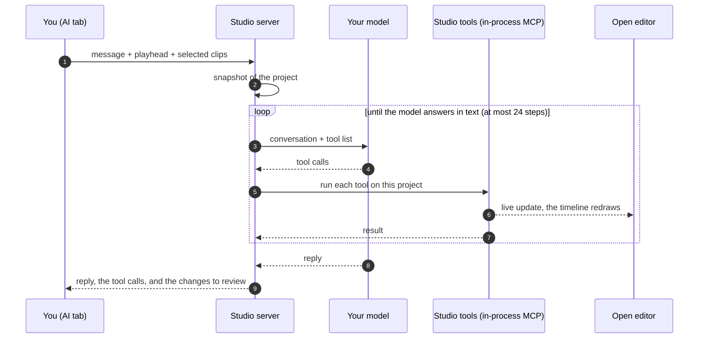

# The AI agent in the editor

The **AI agent** tab is a chat that edits the open project. You bring the model: a key for a cloud provider, or a model running on your own computer. The agent works with the same tools as the [MCP server](MCP.md), so every change it makes appears on the timeline as it happens. You can stop it at any moment, edit by hand, and ask again.

## Set it up

1. Open the **AI agent** tab (first in the left panel) and press the settings icon.
2. Pick a provider and paste its key. The key is saved in `data/agent.json` on this computer and is only ever sent to that provider.
3. Pick a model. The arrow beside the field loads the provider's own list, so you never type a name from memory.

| Provider | Key from | Notes |
|---|---|---|
| Anthropic Claude | [platform.claude.com](https://platform.claude.com/settings/keys) | Official SDK. Default model `claude-opus-5-5`. A request the model declines is retried on a fallback model automatically. |
| OpenAI | [platform.openai.com](https://platform.openai.com/api-keys) | |
| xAI Grok | [console.x.ai](https://console.x.ai) | |
| Groq | [console.groq.com](https://console.groq.com/keys) | Fast open models |
| OpenRouter | [openrouter.ai](https://openrouter.ai/keys) | One key for many models |
| Together AI | [api.together.ai](https://api.together.ai/settings/api-keys) | |
| Ollama | none | Runs on this computer (`http://127.0.0.1:11434/v1`) |
| LM Studio | none | Runs on this computer (`http://127.0.0.1:1234/v1`) |
| OpenAI-compatible server | optional | Any server with `/chat/completions` and tool calls |

Keys can also come from environment variables: `ANTHROPIC_API_KEY`, `OPENAI_API_KEY`, `XAI_API_KEY`, `GROQ_API_KEY`, `OPENROUTER_API_KEY`, `TOGETHER_API_KEY`.

**Local models** must support tool calls. Some local models, or their chat templates, fail when tools are sent; the studio then says so. In testing, Gemma 4 in LM Studio and Gemma 3 in Ollama could not call tools.

## How it works

- Each message carries the playhead time and the selected clips, so "here" and "this clip" mean what you see.
- The agent cannot create or switch projects, and cannot clone a voice (that needs your consent).
- The agent cannot read files from your disk or download from the internet. You add media to the project; it edits what is there. Text inside the video (captions, transcripts, file names) is treated as content, never as instructions, so a video cannot steer the agent into fetching files or sending data out.
- Before every turn the studio saves a snapshot of the project (the last 30 per project, in `data/snapshots/`; deleting a project deletes them).
- The conversation is kept per project and model while the studio runs. The reset icon starts a new one.

## Plans: approve before big edits

The agent can show a plan and wait. Choose when in the settings, under **Plan before editing**:

| Setting | What happens |
|---|---|
| **Only before big edits** (default) | Small edits go ahead. An edit that would take more than 30% of the video out (counted from the start of the turn, so many small cuts add up), delete five or more clips, delete a layer that has clips, change the frame size, or remove the silences is refused until you approve a plan. |
| **Always** | The agent may look (read the project, captions, transcript, list silences) but every change, and every export, waits for an approved plan. |
| **Never** | No plans; the agent is only asked to check with you before removing a lot. |

The studio enforces this, not the model: it tries the edit on a copy of the project first, and a refused call shows a lock in the chat. The agent then proposes a plan, a summary with numbered steps, and its turn ends. **Approve and run** lets it carry out that plan in its next turn; **Cancel** drops it; writing a message instead asks for a different plan. An approval counts only for a plan that is waiting, and only for one turn. Whatever it then does comes back for review, as below.

## Review the agent's changes

After a turn, a **changes to review** card lists what is different from before the agent started, one row per change:

| Row | Means |
|---|---|
| **+** Added (cyan) | A new title, clip, caption track… |
| **−** Removed (magenta) | Something the agent deleted |
| **✎** Changed (violet) | What changed: moved, length, motion and zoom, style, text… |
| **Cut 2.0s** | One cut, taken as a whole: the shortened clip, the piece after it and every clip the cut pulled earlier |

- **✓ keeps** a change and **✕ takes it back**; **Keep all** and **Undo all** do every row at once. Taking a change back is an ordinary edit, so Ctrl+Z brings it back.
- The same changes are marked on the timeline: an outline on added and changed clips, a dashed ghost where a removed clip was. Pointing at a row lights up what it touched; clicking it jumps there and selects it.
- Changes from several turns add up in one review until you go through them. The review compares with the project as it was before the agent's first unreviewed turn, so an edit you make by hand meanwhile shows up in it too.
- Stopping the agent halfway still leaves its changes so far to review.
- A change is one clip, track or setting. When the agent both cut and zoomed the same clip, they are one row (the detail line names both).

## REST

| Method | Path | Body | What it does |
|---|---|---|---|
| GET / PUT | `/api/agent/settings` | `provider`, `model`, `baseUrl`, `key`, `planMode` (`big`, `always`, `off`) | Read or change the provider; keys are never returned, only a hint of the last 4 characters |
| GET | `/api/agent/models` | | The provider's model list |
| POST | `/api/projects/:id/chat` | `text`, `playhead?`, `selection?`, `approve?`, `declined?` | One turn, streamed as JSON lines: `start` (with the turn's `snapshot`), `text`, `tool`, `result` (`blocked: true` when the studio refused it), `plan` (`summary`, `steps`), `error`, `done` (with `snapshot` when the turn changed the project). `approve: true` approves the plan that is waiting; `declined: true` tells the agent the user cancelled it |
| DELETE | `/api/projects/:id/chat` | | Forget the conversation |
| GET | `/api/projects/:id/snapshots/:snapshot` | | The project as it was before that turn (the review's baseline) |
| POST | `/api/projects/:id/restore` | `snapshot` | Put the project back as it was before that turn |
