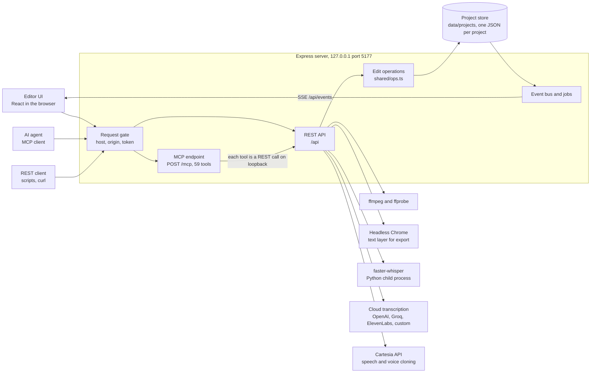
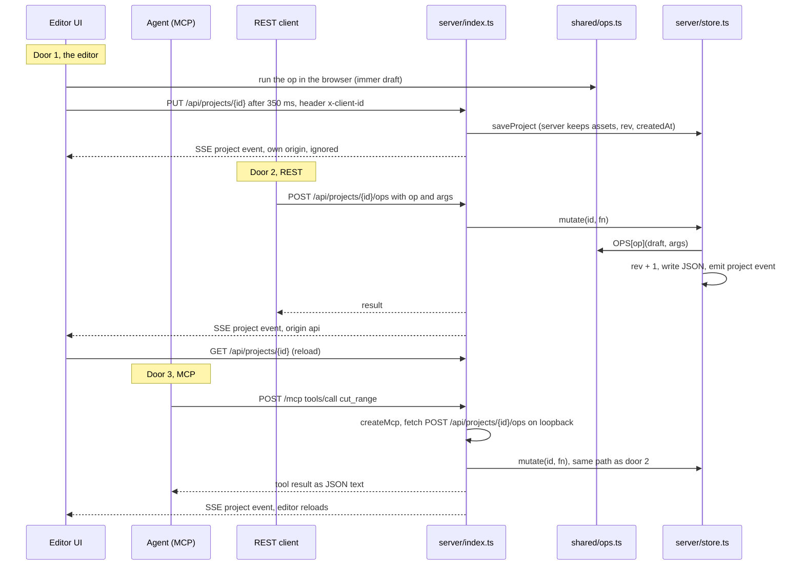
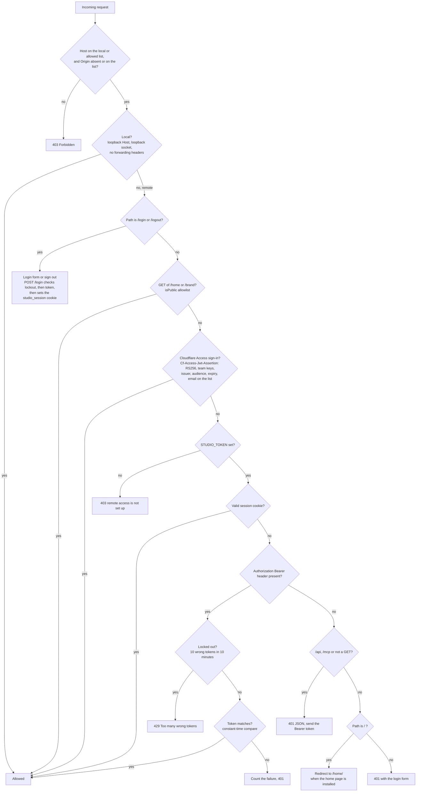
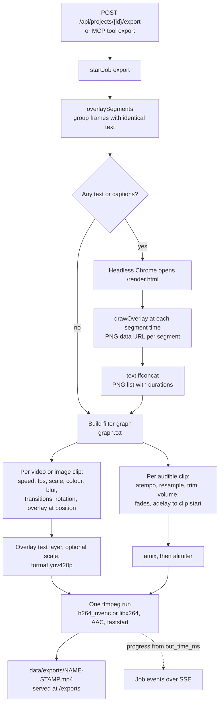
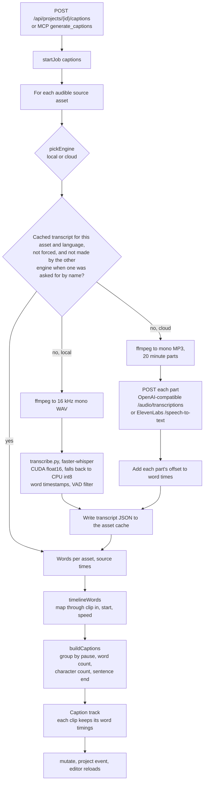
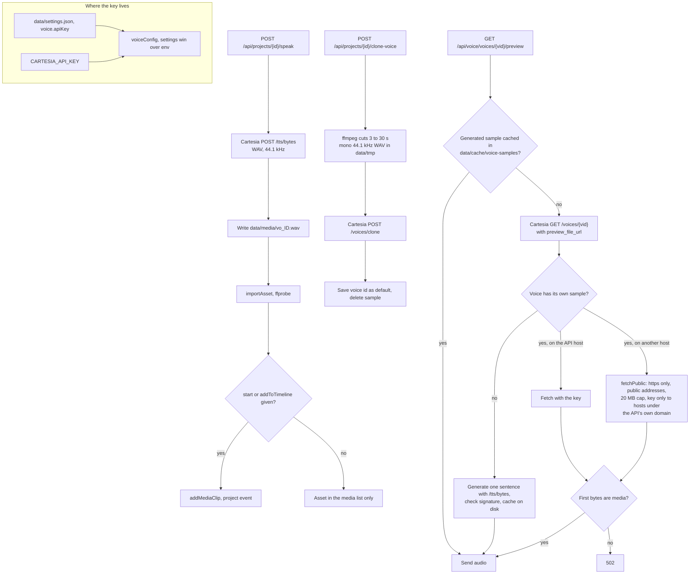
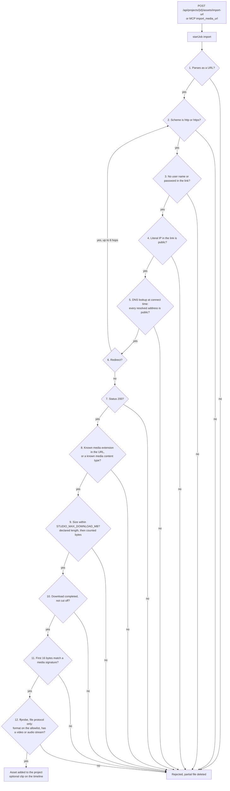
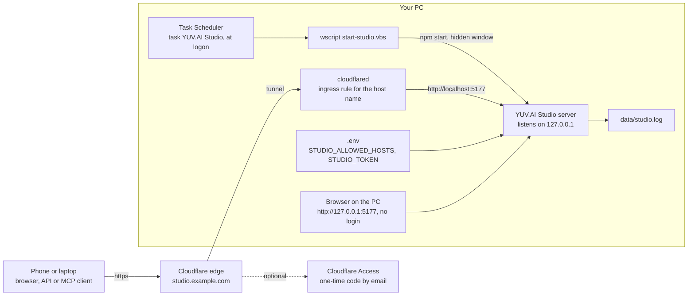
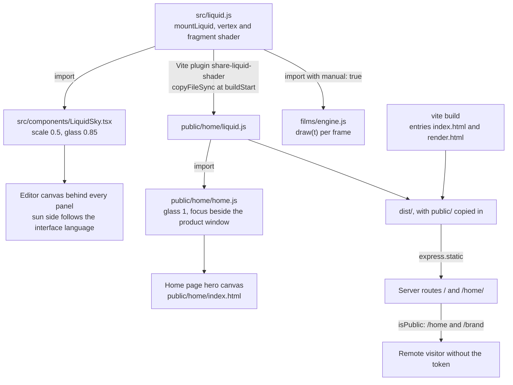

# YUV.AI Studio architecture

YUV.AI Studio is a video editor that runs as one Node.js process on your own computer. An Express 5 server holds the projects, serves a React 19 editor built with Vite, exposes every edit as a REST call, and wraps the same REST calls as an MCP server so an AI agent can edit alongside you. Heavy work is handed to tools on the same machine (ffmpeg, headless Chrome, faster-whisper) or to two kinds of outside API (cloud transcription, Cartesia for speech). This guide shows how the parts connect, with one diagram per subsystem. Every arrow was checked against the code named in the "Where it lives" tables.

Terms used throughout:

- **Op**: one named edit operation in `shared/ops.ts`, for example `cut_range`.
- **MCP**: Model Context Protocol, the way an AI agent calls the studio's tools.
- **SSE**: server-sent events, a one-way stream from the server to the open editor (`GET /api/events`).
- **Job**: a long task (export, transcription, captions, proxy, import) that runs in the background and reports progress.

## Contents

1. [The big picture](#1-the-big-picture)
2. [One edit, three doors](#2-one-edit-three-doors)
3. [Who gets in](#3-who-gets-in)
4. [Export pipeline](#4-export-pipeline)
5. [Captions pipeline](#5-captions-pipeline)
6. [Narration and voice cloning](#6-narration-and-voice-cloning)
7. [Import by link](#7-import-by-link)
8. [Remote access and autostart](#8-remote-access-and-autostart)
9. [The interface: sky shader and home page](#9-the-interface-sky-shader-and-home-page)

## 1. The big picture

Three kinds of client talk to one server: the editor in a browser, an AI agent through MCP, and any program that calls the REST API. The server keeps each project as one JSON file and an in-memory copy, and announces every change on an internal event bus. Media work is done by child processes (ffmpeg, ffprobe, Python, headless Chrome); only cloud transcription and Cartesia leave the machine.

| Part | Where it lives |
|---|---|
| Server entry, routes, access control, SSE | `server/index.ts` |
| Project files, cache, event bus, jobs | `server/store.ts` |
| Project model shared by UI, API, MCP and exporter | `shared/types.ts` |
| Edit operations | `shared/ops.ts` |
| MCP tools | `server/mcp.ts`, `server/mcp-stdio.ts` |
| Editor UI | `src/` |
| Probing, thumbnails, waveform peaks, proxies | `server/media.ts` |

## 2. One edit, three doors

There is one project model (`shared/types.ts`) and one set of edit functions (`shared/ops.ts`). The editor imports those functions and runs them in the browser, then saves the whole timeline. REST clients post an op by name to `/api/projects/{id}/ops`, where the server runs the same function on its stored copy. Each MCP tool is a thin wrapper that calls the REST API over loopback, so an agent's edit takes the REST path too.

Every save bumps the project's `rev` and emits a `project` event carrying the id of whoever made the change. The open editor listens on SSE and reloads the project when the change came from someone else. Its own saves carry its client id in the `x-client-id` header, so it ignores them.

`OPS` holds 32 named operations. Of the 59 MCP tools, 30 post a single op; the rest call dedicated endpoints because they need files or outside services (import, stock search, transcription, captions, translation, silences, sound effects, voice, export, jobs). Some edits in the editor also run on the server for the same reason: the UI first flushes pending saves, calls the endpoint, then reloads.

| Part | Where it lives |
|---|---|
| Op table `OPS` and the functions behind it | `shared/ops.ts` |
| UI store: local edit, debounced save, undo, SSE listener | `src/store.ts` |
| UI HTTP client and `clientId` | `src/api.ts` |
| UI actions that call ops or the server | `src/actions.ts`, `src/components/` |
| `POST /api/projects/:id/ops`, `PUT /api/projects/:id`, `GET /api/events` | `server/index.ts` |
| `mutate`, `saveProject`, `bus` | `server/store.ts` |
| MCP tool wrappers, stateless Streamable HTTP at `/mcp` | `server/mcp.ts`, `server/index.ts` |
| stdio launcher for clients that start a process (`STUDIO_URL`, `STUDIO_TOKEN`) | `server/mcp-stdio.ts` |

## 3. Who gets in

The API can read any file path it is given, so the server decides for every request whether it is local or remote. A request is local only when three things hold: the `Host` header is a loopback name on the studio's port, the socket address is loopback, and no forwarding header is present (`x-forwarded-for`, `x-forwarded-host`, `x-real-ip`, `forwarded`, `cf-connecting-ip`, `cf-ray`). Everything else is remote and must show a Cloudflare Access sign-in, a session cookie or the access token.

With `STUDIO_ACCESS_TEAM`, `STUDIO_ACCESS_AUD` and `STUDIO_ACCESS_EMAILS` set, a remote request that carries Cloudflare Access's signed login (`Cf-Access-Jwt-Assertion`) is let in when the signature checks against the team's public keys (fetched from `https://<team>.cloudflareaccess.com/cdn-cgi/access/certs` and cached) and the issuer, audience, expiry and email all match. The token stays as a second way in, for scripts and MCP clients. Setup in [REMOTE.md](REMOTE.md).

Wrong tokens are counted for the whole server. After 10 failures within 10 minutes no token is compared until the window ends; a browser that already holds a session keeps working. Sessions are random 256-bit ids stored only as SHA-256 hashes, last 30 days, and are dropped when `STUDIO_TOKEN` changes. The server refuses to start with `STUDIO_ALLOWED_HOSTS` set unless the token has at least 32 characters and 12 distinct ones.

| Part | Where it lives |
|---|---|
| Host and Origin check, local or remote flag | `server/index.ts` (first middleware) |
| Token strength check at startup | `server/index.ts` |
| Lockout counter (`guard`, `lockedOut`, `failed`) | `server/index.ts` |
| Sessions (`newSession`, `validSession`, `data/sessions.json`) | `server/index.ts` |
| Public allowlist `isPublic`, login page, `/login`, `/logout` | `server/index.ts` |
| Remote gate (cookie, bearer, redirects) | `server/index.ts` (second middleware) |

## 4. Export pipeline

An export is a job. Text and captions are drawn first: headless Chrome opens `render.html`, which loads the same drawing code the preview uses, and returns one PNG per stretch of frames in which the text layer does not change. Then a single ffmpeg run builds the whole timeline from one filter graph: video and image clips are stacked bottom layer first with `overlay`, audio clips are delayed to their start time and mixed, and the text pictures are laid on top.

The encoder is `h264_nvenc` when a test encode shows it works on the machine, otherwise `libx264`. Audio is AAC at 192 kbit/s. The file is written to `data/exports` and served under `/exports`.

| Part | Where it lives |
|---|---|
| `exportProject`, filter graph, encoder choice | `server/export.ts` |
| `renderTextLayer` (Puppeteer, `findBrowser`, `CHROME_PATH`) | `server/export.ts` |
| Text renderer page and its `__setProject`, `__renderAt` hooks | `render.html`, `src/render.ts` |
| `drawOverlay`, `overlaySegments` | `shared/renderText.ts` |
| Clip rectangle and transition constants | `shared/geometry.ts` |
| `hasNvenc`, `run` | `server/media.ts` |
| Export route, job polling (`/api/jobs/:id?wait=1`) | `server/index.ts` |

## 5. Captions pipeline

Captions start from a transcript with a start and end time for every word. The server transcribes each source file that is audible on the timeline (unmuted clips on unmuted video or audio tracks, built-in sound effects excluded) and caches the result per asset and language. The engine is chosen by the request or by the saved setting; `auto` means local when a Python with `faster_whisper` is found, otherwise cloud when a key is configured.

Captions follow cuts in two ways. When captions are built, `timelineWords` maps each source word through every clip's `in`, `start` and `speed`, so words that were cut out are dropped and the rest land at their timeline times. After that, `cut_range` removes a range from every track, caption track included, and closes the gap.

| Part | Where it lives |
|---|---|
| Engine choice, cache, local and cloud paths | `server/transcribe.ts` |
| faster-whisper script (`PROGRESS` lines, JSON out) | `server/transcribe.py` |
| Provider defaults, key lookup (`sttConfig`) | `server/settings.ts` |
| `timelineWords`, `buildCaptions`, `cutRange`, `toSrt` | `shared/ops.ts` |
| Routes: `transcribe`, `timeline-transcript`, `captions`, `captions.srt` | `server/index.ts` |
| Word highlight drawing | `shared/renderText.ts` |
| Captions tab | `src/components/CaptionsTab.tsx` |

## 6. Narration and voice cloning

Speech comes from the Cartesia API. `speak` sends text and a voice id, receives a WAV file, stores it in `data/media`, registers it as an audio asset and optionally places it on the timeline. `clone-voice` cuts 3 to 30 seconds of speech out of a project asset with ffmpeg, uploads it, and saves the new voice as the default.

The Cartesia key lives in `data/settings.json` on the server machine, or in the `CARTESIA_API_KEY` environment variable when the settings file has none. The browser can write the key but never reads it back: `GET /api/settings` returns only a flag and the last four characters. The sample-preview path is the one place where the server fetches an address it was handed by an outside service, so it has its own checks.

| Part | Where it lives |
|---|---|
| `speak`, `cloneVoice`, `listVoices`, `voicePreview` | `server/voice.ts` |
| `voiceConfig`, `saveSettings`, `publicSettings` | `server/settings.ts` |
| `fetchPublic`, `looksLikeMedia` | `server/fetchUrl.ts` |
| Voice routes | `server/index.ts` |
| Voice tab | `src/components/VoiceTab.tsx` |
| MCP tools `list_voices`, `speak`, `clone_voice` | `server/mcp.ts` |

## 7. Import by link

Import by link downloads a media file from a public address into `data/media`. Because the studio can be reachable from the internet, this path must not become a way to read the home network or to make ffmpeg open other files. The checks below run in this order; any failure stops the import, and a file already written is deleted.

The address check runs inside the DNS lookup used for the connection itself, so a host name cannot pass the check and then resolve to a private address. Every redirect goes through the same function again.

Step 12 applies to every import, including uploads and import by path: `probe` runs ffprobe with `-protocol_whitelist file` and accepts only real container formats, because playlist and script formats can make ffmpeg open other files and addresses.

| Part | Where it lives |
|---|---|
| `downloadMedia`, `get`, redirect loop, size cap | `server/fetchUrl.ts` |
| Blocked address ranges, `isPublicAddress`, `publicLookup` | `server/fetchUrl.ts` |
| `looksLikeMedia` signature check | `server/fetchUrl.ts` |
| `probe` (protocol whitelist, `MEDIA_FORMATS`), `importAsset` | `server/media.ts` |
| Import route and job | `server/index.ts` |

## 8. Remote access and autostart

The server listens on `127.0.0.1` only. To reach it from elsewhere, a Cloudflare Tunnel on the same PC forwards one public host name to `http://localhost:5177`. That host name must be listed in `STUDIO_ALLOWED_HOSTS`, and requests arriving through the tunnel are treated as remote (section 3), so they need `STUDIO_TOKEN`. Cloudflare Access can be added in front as an optional second lock.

A Task Scheduler task runs `scripts/start-studio.vbs` at logon. The script runs `npm start` with no window and writes output to `data/studio.log`. There is no watchdog: if the studio crashes it stays down until the next logon or until the task is started by hand.

| Part | Where it lives |
|---|---|
| Setup steps, tunnel rule, scheduled task command | `docs/REMOTE.md` |
| Start script | `scripts/start-studio.vbs` |
| `HOST`, `PORT`, `STUDIO_ALLOWED_HOSTS`, `STUDIO_TOKEN` handling | `server/index.ts` |
| `npm start` (loads `.env` when present) | `package.json` |

## 9. The interface: sky shader and home page

The background of the editor and of the home page is one WebGL fragment shader, the studio backdrop of the Neon Studio look: near-black with slow noise-driven washes of violet and blue, cyan light from one side, and a few soft bokeh lights that drift. A small light follows the pointer. The shader pauses when its canvas is off screen or the tab is hidden, and draws a single still frame when the visitor prefers reduced motion.

The source of truth is `src/liquid.js`. The editor imports it through the React component `LiquidSky`. The home page (optional; it is not part of the open-source edition) is plain static files in `public/home`, outside the React bundle, so a small Vite plugin copies `src/liquid.js` to `public/home/liquid.js` at the start of every build. The home page and the brand images are the only paths a remote visitor can read without the token.

| Part | Where it lives |
|---|---|
| Shader and `mountLiquid` (`set`, `destroy`, `draw`) | `src/liquid.js` |
| Editor background component | `src/components/LiquidSky.tsx` |
| Copy plugin and build entries | `vite.config.ts` |
| Home page markup, script, styles, screenshots | `public/home/index.html`, `home.js`, `home.css`, `shots/` |
| Brand images | `public/brand/` |
| Static serving, dev mode through Vite middleware | `server/index.ts` |

## Mobile mode and uploads (0.5.0)

| Part | File |
|---|---|
| Phone detection (narrow screen and touch, or `?m=1`; `localStorage studio.ui` remembers "Full editor") | `src/main.tsx` |
| The mobile mode: home, upload, captions, style, agent, export. It reuses the editor's store, `Stage` and `AgentTab`, and long-polls jobs so progress survives the phone sleeping | `src/mobile/MobileApp.tsx`, `src/mobile/mobile.css` |
| Resumable uploads in 8 MB pieces (Cloudflare refuses requests over 100 MB). A piece at the wrong offset gets 409; the client asks where to continue | `server/uploads.ts`, `uploadChunked` in `src/api.ts` |
| Installable app and Android share target. The service worker caches nothing of the app or the data; it parks a shared file for the mobile mode | `public/manifest.webmanifest`, `public/sw.js`, `src/mobile/share.ts` |
| Reshaping for another destination: changes the frame and re-fits full-frame clips, so captions stay inside (cropping at export would cut them) | `reshapeProject` in `shared/ops.ts` |

