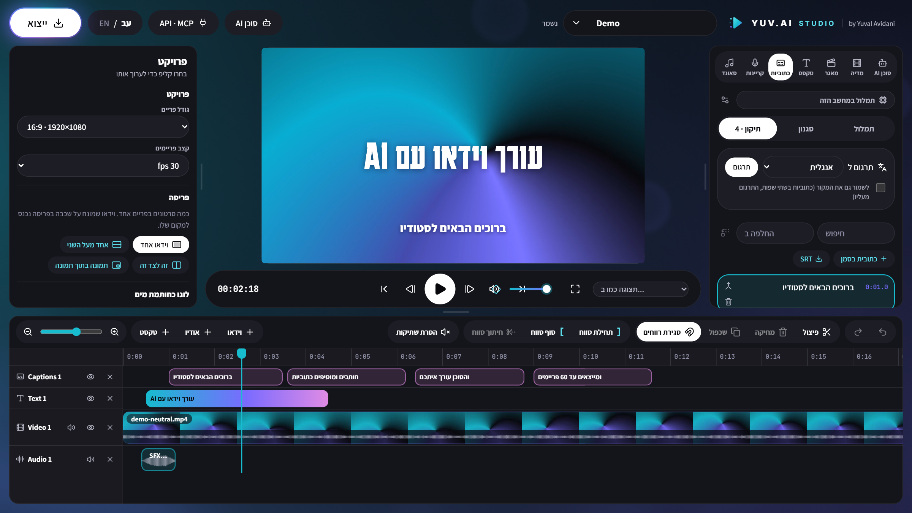

# Transcription and captions

Captions need word timings: when each word starts and ends. The studio can get them in two ways.

| | On this computer | Through an API |
|---|---|---|
| Engine | faster-whisper | OpenAI, Groq, ElevenLabs, or any OpenAI-compatible server |
| Needs | Python with `faster-whisper`; a CUDA GPU to be fast | An API key and an internet connection |
| Cost | Free | Paid per minute of audio (Groq has a free tier) |
| Privacy | The audio never leaves the machine | The audio is uploaded to the provider |
| Hebrew | ivrit.ai Whisper fine-tune, the most accurate option here | Whatever the provider's model gives |

## Choosing the engine

Open **Captions** and press the settings icon next to the engine line.

- **Automatic** (default): this computer when faster-whisper is installed, otherwise the cloud provider.
- **This computer** or **Cloud**: always use that one.

The line above the tabs always says which engine will run.

## Local setup

```bash
pip install "faster-whisper>=1.1"
# NVIDIA GPU on Windows or Linux, in the same Python: the CUDA 12 and cuDNN 9 libraries, no system CUDA needed
pip install nvidia-cublas-cu12 "nvidia-cudnn-cu12==9.*"
```

The studio looks for a Python that can `import faster_whisper`; point it at a specific one with `STUDIO_PYTHON` (the [AI install prompt](AI_INSTALL_PROMPT.md) makes a `.venv` in the studio folder and sets it). The CUDA libraries installed with pip are found inside that Python, so nothing has to be added to PATH (verified on Windows; on Linux the studio preloads them). The studio passes Whisper the audio samples itself, so the version of PyAV that pip installs does not matter. The first transcription downloads the model (about 1.6 GB for Hebrew, 3 GB for `large-v3`). Without a working GPU it falls back to the CPU, which is slow for long videos.

| Variable | Default |
|---|---|
| `WHISPER_MODEL_HE` | `ivrit-ai/whisper-large-v3-turbo-ct2` |
| `WHISPER_MODEL_EN` | `large-v3` |
| `WHISPER_MODEL_AUTO` | `large-v3` |

Without an NVIDIA GPU (and on a Mac) set `WHISPER_MODEL_EN` and `WHISPER_MODEL_AUTO` to `large-v3-turbo`: several times faster on a CPU, nearly as accurate.

## Cloud setup

In the engine settings choose a provider and paste its key. Leave the model empty for the default.

| Provider | Default model | Endpoint used |
|---|---|---|
| OpenAI | `whisper-1` | `POST /v1/audio/transcriptions` with `timestamp_granularities[]=word` |
| Groq | `whisper-large-v3` | The same request on `api.groq.com/openai/v1` |
| ElevenLabs | `scribe_v1` | `POST /v1/speech-to-text` with `timestamps_granularity=word` |
| OpenAI-compatible | `whisper-1` | The same request on your base URL |

The key is saved in `data/settings.json` on the machine that runs the studio. The browser can set it but never reads it back. You can also provide it as `OPENAI_API_KEY`, `GROQ_API_KEY` or `ELEVENLABS_API_KEY` in `.env`.

The audio is sent as small mono MP3 in 20-minute parts, so long videos stay under the providers' upload limits. A word that falls exactly on a part boundary can be cut; fix it in the caption editor.

The model must return word timestamps. A model that returns only text will not work here, and the job says so.

> The cloud path was verified against a local stand-in for the OpenAI-compatible API, not against the live providers. If a provider rejects the request, the job shows the provider's own error message.

## Fixing the captions



**Captions > Fix text** lists every caption in order.

- **Edit a line:** click it and type. The preview jumps to that caption. When the number of words stays the same, each word keeps its timing, so the highlight stays in sync. When it changes, the timings are spread evenly over the caption.
- **Replace everywhere:** type the wrong word and the right one, then press the replace button. Useful for a name the engine keeps mishearing.
- **Merge** a caption with the next one, **delete** one, or add a **caption at the playhead**.
- **Split** a caption: put the playhead inside it on the timeline and press `S`.
- **Timing:** drag a caption or its edges on the timeline.
- **SRT** downloads the captions as a subtitle file.

Generating captions again replaces everything on the caption track, including manual fixes. The studio asks before doing that.

Transcripts are saved per source file and language, so generating again after more cuts does not transcribe again. Use "Transcribe again from scratch" after switching engines.

## Captions in another language

Hebrew speech with English captions, English speech with Hebrew captions, or Spanish, French, German, Italian, Portuguese or Russian.

- **While generating:** in **Captions > Transcribe**, set **Spoken language** to what is said in the video and **Caption language** to what viewers should read. The speech is transcribed, then translated.
- **Captions you already fixed:** in **Captions > Fix text**, choose a language under **Translate to** and press **Translate**. Tick **Keep the original too** for captions in two languages: the translation goes on its own caption layer, one line above the original, and each layer can be styled, moved or hidden on its own.

The translation is done by the model set in the **AI agent** tab: Claude, OpenAI or another provider with your own key, or a model running on your computer (Ollama, LM Studio). Every caption keeps its exact timing: the model translates caption by caption, with the captions around it as context, so it stays on screen while those words are spoken. The word highlight is spread over the translated words.

A strong model gives natural subtitles; a small local model is free and private but can get names and idioms wrong, so read the result in **Fix text**.

## From the API or an agent

```bash
# generate
curl -X POST http://127.0.0.1:5177/api/projects/<id>/captions -H "content-type: application/json" -d '{"language":"he","engine":"cloud"}'
# read, fix one, replace everywhere
curl http://127.0.0.1:5177/api/projects/<id>/captions
curl -X POST http://127.0.0.1:5177/api/projects/<id>/ops -H "content-type: application/json" -d '{"op":"update_clip","args":{"clipId":"<captionId>","patch":{"text":"the corrected line"}}}'
curl -X POST http://127.0.0.1:5177/api/projects/<id>/ops -H "content-type: application/json" -d '{"op":"replace_in_captions","args":{"find":"cloud","replace":"Claude"}}'
# Hebrew speech, English captions
curl -X POST http://127.0.0.1:5177/api/projects/<id>/captions -H "content-type: application/json" -d '{"language":"he","translateTo":"en"}'
# translate the captions you have, keeping the original as a second layer
curl -X POST http://127.0.0.1:5177/api/projects/<id>/captions/translate -H "content-type: application/json" -d '{"to":"en","keepOriginal":true}'
# subtitle file
curl -O http://127.0.0.1:5177/api/projects/<id>/captions.srt
```

MCP tools: `generate_captions` (with `translateTo`), `translate_captions`, `get_captions`, `edit_caption`, `replace_in_captions`, `add_caption`, `merge_captions`, `set_caption_style`.
