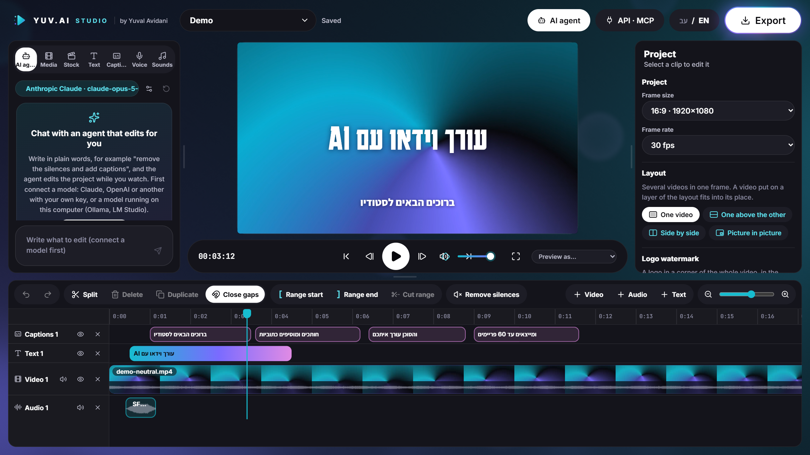

# Using the editor

The screen has four parts: the library on one side (Media, Text, Captions, Sounds), the preview in the middle, the inspector for the selected clip on the other side, and the timeline at the bottom. The language toggle in the top bar switches between Hebrew and English.

## On your phone

Open the studio's address on a phone and it opens in mobile mode (or add `?m=1` to the address anywhere).

1. **New video:** pick a video from the gallery. It is shown first, with its name, length and size; press **Upload and edit** (or **Choose another file**). It uploads in pieces with a progress bar and carries on by itself if the signal drops.
2. **Captions:** choose the spoken language and the caption language (pick another language to get translated captions), then **Make captions**. **Cut silences** removes the pauses. Tap any line to fix a word; it saves when you leave the line.
3. **Style:** tap a look; the preview shows it at once.
4. **AI agent:** the same chat as in the editor, for anything else ("add a title at the start").
5. **Export:** pick where it goes (Reels, TikTok, Shorts, YouTube, square). If the video is horizontal and the destination is vertical, the frame is reshaped first and the preview shows the result. Then **Download**, or **Share** straight to an app.

**Install it:** in the browser menu, "Add to Home screen" (Android) or Share > "Add to Home Screen" (iPhone). On Android you can then share a video from the gallery to "YUV Studio".

The editing runs on the computer that hosts the studio, so it has to be on. **Full editor** at the bottom of the home screen switches to the desktop editor.

## Arrange the screen

- **Resize:** drag the thin bar between the library and the picture, or between the picture and the inspector, to make a panel wider or narrower. Drag the bar above the timeline up or down to make the timeline taller or shorter.
- **Hide and bring back:** the round button on each bar (or a double-click on the bar) collapses that panel or the timeline, so the picture gets the room; the same button brings it back. With the keyboard: focus the bar, then the arrow keys resize and Enter hides or shows.
- **Full screen:** the button at the right of the play controls (or `F`). `Esc` leaves.
- The editor remembers the sizes for next time.

## Start a project

**New project** (in the menu next to the project name) asks for three things:

- **Canvas size:** 16:9 (YouTube), 9:16 (TikTok, Reels, Shorts), 4:5 (Instagram post), 1:1, or 4K. The size you pick stays, whatever video you drop in first.
- **Layout**, for several videos in one frame: **One video**, **One above the other**, **Side by side**, or **Picture in picture**. In a layout, a video you put on the top or the lower video layer fits into its place by itself (the whole picture, centred). Change the layout later in the inspector when nothing is selected.
- Or one of **your templates**.

**Templates:** in the inspector with nothing selected, **Save as a template** keeps the canvas, the layers, the layout, the titles and the logo (not the footage or the captions). The template then appears under New project; the bin icon on it deletes it.

## Bring in footage

- Drop files anywhere on the window, or press **Upload files**.
- Or paste a file path from this computer into the path field. The file is used where it is, nothing is copied.
- In a project made the quick way (no size chosen), the first video you add sets the frame size and frame rate. Change them any time in the inspector when nothing is selected (16:9, 9:16, 4:5, 1:1, 4K; 24 to 60 fps).

Formats a browser cannot play (HEVC, ProRes, MKV, 10-bit) get a preview copy made in the background. Export always uses the original file.

## Free stock: B-roll, overlays, photos, music

The **Stock** tab searches free libraries from inside the editor:

| Source | What | Key |
|---|---|---|
| Openverse | Photos, music and sound effects under licences that allow use in a video that may be commercial and edited | None |
| Pexels | Videos and photos | Free, in a minute, no card: [pexels.com/api](https://www.pexels.com/api/new/) |
| Pixabay | Videos and photos | Free: [pixabay.com/api/docs](https://pixabay.com/api/docs/#api_key) |

Pick a kind (**Video B-roll**, **Overlays**, **Photos**, **Music & SFX**), type a search (English works best) or press a topic, and choose:

- **+** puts the clip on a layer above, at the playhead (B-roll).
- **The layers button** (Overlays) puts it over the whole frame on a new top layer with the **Screen** blend: the black disappears and only the light stays (light leaks, film grain, dust, bokeh, flares, smoke).
- **The film button** only adds it to the media list.

Keys are pasted once under the key button and stay on this computer. Every file keeps its source and licence; Openverse items under CC BY or BY-SA need a credit, and **Copy credits** puts all of them on the clipboard for the video description. Mixkit is free too but has no API: download there and drop the file on the editor.

## Cut

| To do this | Do this |
|---|---|
| Trim the start or the end | Drag the edge of the clip |
| Split a clip | Put the playhead there and press `S` |
| Delete a clip | Select it and press `Del`. With **Close gaps** on, the clips after it move left |
| Cut a part out of the whole timeline | `I` (or `[`) at the start, `O` (or `]`) at the end, then `X` or the **Cut the range** button that appears on the range. IN and OUT flags show on the ruler and a message says what was marked. `Alt+X` clears the marks |
| Move a clip in between others | Drag it there: a glowing line shows where it goes in, and the clips from there on move right to make room. Dropped on the first half of a clip it goes before it, on the second half after it. With **Close gaps** on, the place it left closes |
| Change speed | Select a video or audio clip: **Speed** in the timeline toolbar or in the inspector (0.25× to 4×, or any value with the slider), or right-click the clip. Slower makes the clip longer and the clips after it move right |
| Everything for one clip | Right-click it: split, keyframe, speed, detach the audio, mute, duplicate, delete |
| Remove pauses | **Remove silences** in the timeline toolbar |
| Undo, redo | `Ctrl+Z`, `Ctrl+Y` |

Clips snap to the playhead and to the edges of other clips while you drag them. Captions and titles drag and make room the same way.

## Layers

Tracks are layers. The top track is in front. A new project starts with two video layers and two audio layers, so you can put one clip above another right away.

- **B-roll and overlays:** press the layers icon on a media item to put it above the main video at the playhead, muted. Or drag it from the library onto a higher video track.
- **Move, resize, rotate:** select a clip and drag it on the preview. The corner handles resize, the top handle rotates. It snaps to the centre of the frame.
- **Add or remove tracks:** the `+ Video`, `+ Audio`, `+ Text` buttons, and the `×` on a track.
- Mute or hide a whole track from its header.

## Titles and text

Open the **Text** tab and click a style. The text lands at the playhead; type your own in the inspector. Each text has its own font, size, colours, outline, background, alignment and in / out animation (fade, pop, slide, typewriter). Hebrew and English can be mixed in one line.

## Captions

See [TRANSCRIPTION.md](TRANSCRIPTION.md) for the engines. In short:

1. **Captions > Transcribe:** choose the spoken language and press **Generate captions**.
2. **Captions > Style:** pick one of 9 looks. Select a caption on the preview to drag or resize all of them together.
3. **Captions > Fix text:** correct each line, replace a word everywhere, merge, delete or add captions, download an `.srt`.

**Captions in another language:** set **Caption language** next to the spoken language (for example Hebrew speech, English captions), or translate the captions you already fixed with **Translate to** in **Fix text**; **Keep the original too** gives captions in two languages. The translation uses the model from the AI agent tab and keeps every caption's timing. Details in [TRANSCRIPTION.md](TRANSCRIPTION.md#captions-in-another-language).

Captions are built from the timeline, so make your cuts first. Cutting a range afterwards (`I`, `O`, `X`) cuts the captions with the video; deleting a single clip does not move them.

## Looks, transitions, speed

Select a video or image clip. The inspector has:

- **Look:** presets (Vivid, Cinematic, B&W, ...) and sliders for brightness, contrast, saturation and blur.
- **Transition in / out:** fade, dip to black, white flash, blur, zoom in, zoom out, spin, slide and wipe in four directions, with a duration.
- **Speed** from 0.25× to 4×, **volume**, mute, opacity.

A transition belongs to one clip. For a crossfade between two clips, put them on two layers so they overlap, and fade the upper one.

## Motion: zooms and keyframes

Select a video, image or title clip and open **Motion and zoom** in the inspector.

- **A ready-made zoom:** pick how much (the zoom amount) and how smooth, then press *Slow zoom in*, *Slow zoom out* (both run over the whole clip) or *Punch in at playhead* (in quickly, two seconds close, back out).
- **Ready moves:** under **Motion and zoom**, each ready move (slow zoom in / out, punch in, pan right / left) is a small animated preview of what it does, played with the smoothness you pick. The smoothness tiles draw each curve with a dot running along it.
- **Your own move, the quick way:** select the clip, put the playhead where the move starts and press `K` (or the diamond next to the play button, or **Keyframe** in the timeline toolbar). Move the playhead, then drag or resize the clip on the preview: the next keyframe is made for you. `K` on an existing keyframe removes it; `Shift+J` / `Shift+K` jump to the previous / next one.
- **Pick a keyframe:** click its diamond on the timeline clip, or its chip in the inspector's keyframe list. It lights up and the playhead jumps to it. Drag the diamond sideways to move it to another moment; `Delete` removes just that keyframe; `Esc` lets go of it.
- **Your own move, in the inspector:** press the diamond to put a keyframe at the playhead. Move the playhead, then change the size, position, rotation or opacity, in the inspector or by dragging on the preview. That makes a second keyframe, and the clip glides between the two.
- **Smoothness** is set per keyframe and shapes the move that arrives at it: smooth (ease in and out), ease out, ease in, constant speed, or hold and jump.
- Keyframes show as gold diamonds on the clip. The arrows jump to the previous and next one; the bin removes all the motion of the clip.

Once a clip has a keyframe, every change to its transform at another moment makes a keyframe there. Splitting or trimming a clip keeps its motion where it was.

## Layers: change their order

Drag a track's name (on the left of the timeline) up or down. A clip can also be dragged from one track to another of the same kind. Drag a clip above the top layer of its kind, or below the lowest one, and a dashed line says **Let go here for a new layer**: letting go makes that layer with the clip on it.

## Audio: fades and separating it from the video

- **On the clip itself:** select a clip with sound. The line across it is the volume: drag it up or down (it shows the %). The white dots in its top corners are the fades: drag them inwards for a fade in and a fade out.
- **In the inspector:** the **Audio** section has the same volume, fade in and fade out, in numbers.
- **Detach the audio:** on a video clip with sound, press **Detach the audio** in the timeline toolbar (or right-click the clip, or the Audio section). The sound goes onto an audio layer as its own clip, at the same time, and the video clip is muted. Then move, trim, speed up or fade the sound on its own.

## Blend modes

Select a video or image clip: **Blend with the layers below** sets how it mixes with what is under it. **Screen** keeps only the light (for overlays on black), **Lighten** keeps the lighter of the two, **Multiply** keeps only the dark (paper, textures on white), **Overlay** adds contrast (grain, textures). The preview and the export match.

## Logo watermark

In the inspector with nothing selected, **Logo watermark**: upload a logo (a PNG with a transparent background looks best) or pick an image already in the project, then choose the corner, the size, the opacity and the margin. It is drawn above everything in the preview and in every export; when an export changes the shape (a 16:9 project exported for TikTok), the logo keeps its corner and size in the new frame.

## Fonts

In the **Text** tab, under **Fonts**: type the name of any Google Fonts family and press the download button, or install a TTF, OTF, WOFF or WOFF2 file. Choose the **default font for new titles** there too. A title that names a font you do not have yet (also when an AI agent asks for it) downloads it from Google Fonts by itself. Added fonts are used by the export exactly as in the preview.

## Export for a platform

The export dialog has presets for YouTube, YouTube 4K, Shorts, Reels, TikTok, an Instagram post (4:5), a square, X and LinkedIn. Each sets the size, frame rate and a bitrate ceiling. **Pick several** (for example YouTube and TikTok and Reels) and each comes out as its own file, rendered one after the other, with the platform in the file name. When a preset's shape differs from the project's, choose **Fit** (the whole picture over a blurred copy) or **Fill** (crop the edges).

**Preview as a platform:** the menu at the right of the play controls (**Preview as…**) draws, over the preview, what a **Fill** export keeps (the rest is dimmed) and the edges the app's own buttons, caption and top bar cover (striped), with a dashed line around the safe area. The safe areas are approximate: each app moves its buttons a little between versions and phones.

## The AI agent

Press **AI agent** in the top bar (or the first tab of the library): a chat with an AI model of your choice that edits the project while you watch. Write in the box at the bottom; until a model is connected, a card explains it and **Connect a model** opens the settings (a provider and your own key, or a model on this computer). Before a big edit it shows you a plan and waits for your approval (or before every edit, if you choose). After each turn you go through its changes one by one, marked on the timeline, and keep or take back each. See [AGENT.md](AGENT.md).

While an AI edits (this agent, or Claude Code and other MCP clients), the frame glows and a labelled cursor goes to each part it changes; the changed clips shimmer. Nothing to turn on.

## Sounds

The **Sounds** tab has 26 effects in four groups. Click one to hear it, press `+` to add it at the playhead. Import your own music as any other file.

## Export

While files upload, a card at the top shows the file, the percent, the speed and the time left, with a cancel button.

Press **Export**, choose quality, size and frame rate. The file is saved in `data/exports/` and offered for download.

## Shortcuts

| Key | Action |
|---|---|
| `Space` | Play / pause |
| `S` | Split at the playhead |
| `Del` | Delete the selected clip |
| `I` / `O`, or `[` / `]` | Mark the start / end of a range |
| `X` | Cut the marked range |
| `Alt+X` | Clear the marks |
| `←` / `→` | One frame back / forward (`Shift` for one second) |
| `Home` / `End` | Start / end of the timeline |
| `Ctrl+D` | Duplicate the clip |
| `Ctrl+Z` / `Ctrl+Y` | Undo / redo |
| `K` | Keyframe at the playhead (again: remove it) |
| `Delete` | With a keyframe picked: remove that keyframe |
| `F` | Full screen (`Esc` leaves) |
| `M` | Mute / unmute the preview (hover the picture for its volume slider) |
| `Shift+J` / `Shift+K` | Previous / next keyframe |
| Right-click a clip | Its menu: split, keyframe, speed, detach audio, mute, duplicate, delete |
| `Ctrl` + wheel | Zoom the timeline |

Shortcuts follow the physical keys, so they work with a Hebrew keyboard layout too, and they keep working after you click a slider or a button.

## Known limits

- A layout fits each video inside its slot whole; there is no cropping of a clip yet, so a 9:16 video in a half-frame slot gets bars at its sides.

- Titles and captions are always drawn above every video layer.
- There is no music library, only short synthesised effects.
- Preview volume stops at 100%; values above that are applied in the export.
